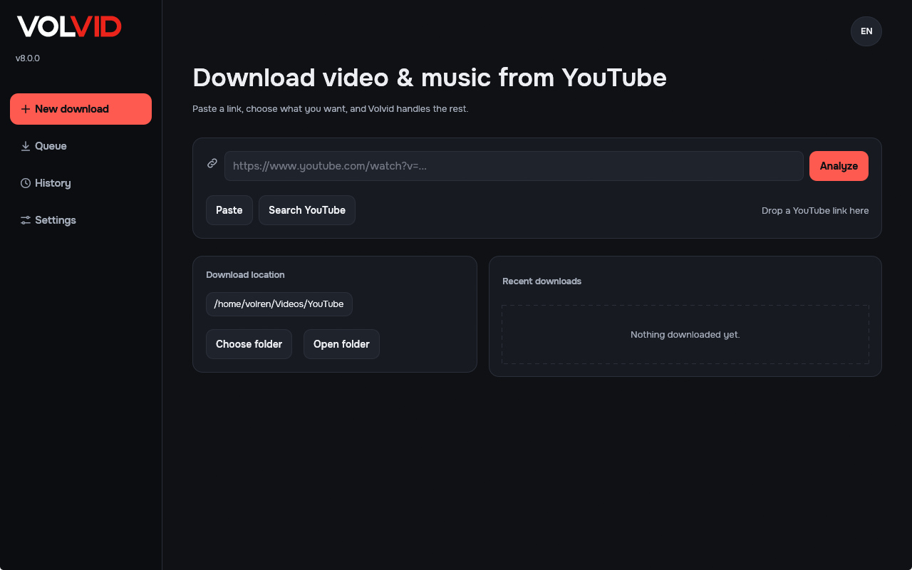

# Volvid

<div align="center">


**A fast, modern YouTube downloader for the desktop — built with Rust, egui and wgpu.**

[](rust-toolchain.toml)
[](#platforms)
[](LICENSE)

[](docs/screenshots/gui.png)

</div>

---

## About

Volvid is a graphical YouTube downloader powered by **yt-dlp** and **ffmpeg**.
It checks dependencies, resolves video metadata and thumbnails, scans real
quality options, and downloads video, audio or thumbnails — including playlists,
fragments, dubbed audio tracks and embedded subtitles.

The v8 release is a complete rewrite in Rust. The previous Go/TUI version has
been removed; the new app is a native GPU-rendered desktop application.

## Features

- **Modern GUI** — egui 0.37 + wgpu, dark/light themes, custom coral/cyan palette.
- **Video preview** — YouTube thumbnails are fetched and shown on the download screen.
- **Quality scan** — real heights, availability and estimated sizes from `yt-dlp`.
- **Formats** — Original MP4, H.264, H.265, VP9, AV1, MKV copy; MP3 320/192, M4A, Opus, FLAC.
- **Playlists** — virtualized list, filter, select all/none, manual ranges and parallel workers.
- **Tracks** — dubbed audio languages and subtitles embedded into the container.
- **Fragments** — `1:00-2:30`, `1:00-`, `1:00+`, and timestamps from the URL.
- **Dependency manager** — detects and installs managed yt-dlp, ffmpeg and node.
- **Browser cookies** — auto-detects Firefox, Chrome, Chromium, Brave, Vivaldi and Opera profiles.
- **Self-update** — GitHub release check and in-place binary replacement.
- **Download queue** — queued/active/paused jobs, progress, speed, ETA, pause/resume and session history.
- **English / Russian** — switch language instantly from the UI.
- **Wayland-native Linux** — no X11 build; XWayland is not used.

## Quick start

### Requirements

- **Rust 1.99.1+** for building from source.
- `yt-dlp` and `ffmpeg` are required at runtime. Volvid can install managed copies
  from the dependency screen if they are missing. `node` is optional (JS runtime).

### Build and run

```bash
git clone https://github.com/VolRencs/Volvid
cd Volvid
cargo build --release -p volvid-gui
./target/release/Volvid
```

Or pass a URL directly:

```bash
./target/release/Volvid 'https://www.youtube.com/watch?v=dQw4w9WgXcQ'
```

### Linux

Volvid targets **Wayland only**. Build and run inside a Wayland session:

```bash
cargo run --release -p volvid-gui
```

### Windows

```powershell
cargo build --release -p volvid-gui
.\target\release\Volvid.exe
```

## Screenshot


## Architecture

```text
crates/
  volvid-core/      pure domain: URL/fragment parsing, profiles, quality, deps, session
  volvid-i18n/      EN/RU strings and formatting
  volvid-engine/    yt-dlp, ffmpeg, HTTP, dependency installs, cookies, updates, config
  volvid-app/       UI-independent state machine, command/event flow, download queue
  volvid-gui/       eframe/egui app, theme, pages, SVG icons and thumbnail preview
assets/
  fonts/            Onest with Cyrillic
  icons/            application icon, logo variants, SVG action icons
docs/               GitHub Pages site and screenshots
```

The GUI never calls `yt-dlp` or `ffmpeg` directly. User actions become
`AppEvent`s; the engine runs on a Tokio runtime and reports progress back to
the UI-independent state machine.

## Runtime paths

| Variable | Role | Default |
|----------|------|---------|
| `VOLVID_CONFIG_DIR` | config | `UserConfigDir/Volvid` |
| `VOLVID_DATA_DIR` | app data | `%LOCALAPPDATA%/Volvid` / `$XDG_DATA_HOME/Volvid` |
| `VOLVID_DEPS_DIR` | managed binaries | `DataDir/deps` |
| `VOLVID_DOWNLOADS_DIR` | fixed download directory | system Downloads |
| `VOLVID_FFMPEG_SHA256` | pin ffmpeg archive checksum | unset |

Configuration is stored in `config.toml`; download history is stored in
`history.json`. The old `.volvid_locale` and `.volvid_downloads_dir` files are
imported once on first launch.

## Development

```bash
cargo fmt --all
cargo clippy --workspace --all-targets -- -D warnings
cargo test --workspace
cargo deny check
cargo run -p volvid-gui
```

Useful environment variables for development:

- `VOLVID_TEST_FRONT=1` keeps the window above other windows (useful for screenshots).
- `RUST_LOG=volvid_gui=debug,volvid_app=debug` enables UI/state logs.

### Project tooling

- `cargo nextest` for fast test runs (optional).
- `cargo deny check` runs in CI for dependency policy.
- `cargo audit` for additional advisory checks (optional).
- `egui_kittest` for headless UI tests.

## Platforms

| OS | Arch | Status |
|----|------|--------|
| Windows 10/11 | x86_64 | supported |
| Linux (Wayland) | x86_64 | supported |
| Linux (X11) | x86_64 | not supported |

## License

Licensed under **GPL-3.0** — see [`LICENSE`](LICENSE).
Copyright (C) 2026 VolRen.

External tools:

- [yt-dlp](https://github.com/yt-dlp/yt-dlp) — Unlicense
- [ffmpeg](https://ffmpeg.org) — LGPL/GPL
- [egui / eframe](https://github.com/emilk/egui) — MIT/Apache-2.0
- [Tokio](https://tokio.rs) — MIT
- [Onest](https://github.com/simpals/onest) — OFL
